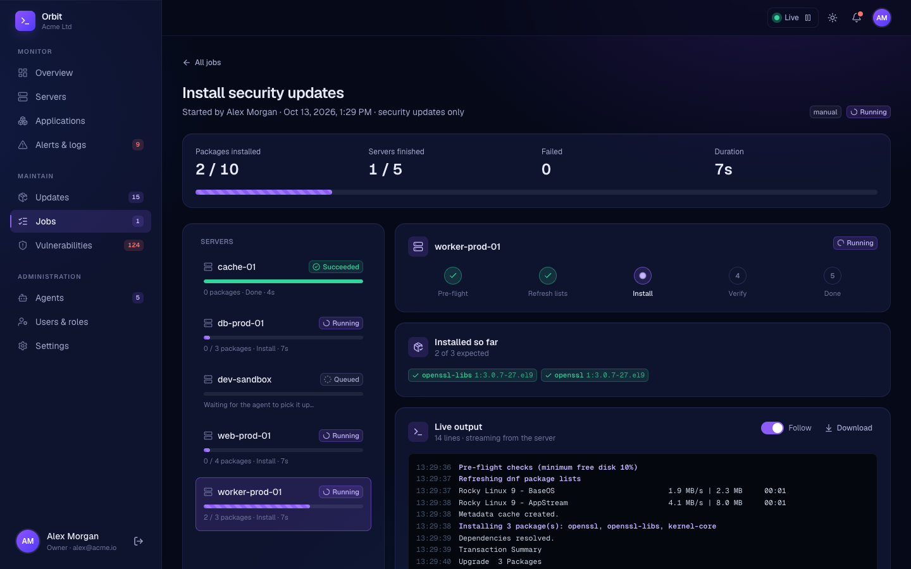
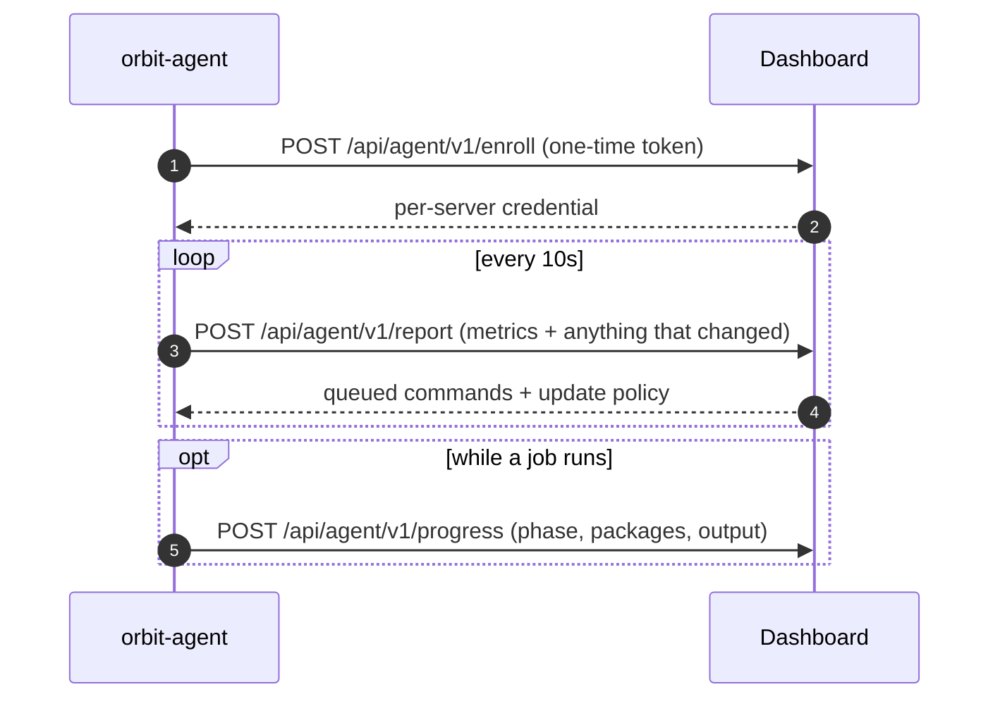
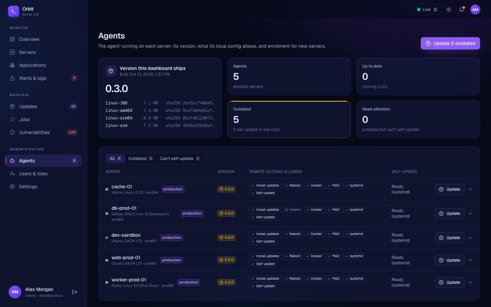

<div align="center">


# Orbit agent

**A small, static Go binary that connects each Linux server to the [Orbit](https://github.com/Orbit-Auto-Updater/orbit-dashboard) dashboard.**

Metrics, apps, errors and package updates, reported over outbound HTTPS. No open ports and no shell access.

[](https://go.dev)
[](#-install)
[](#)
[](#-firewall)

[Install](#-install) · [Firewall](#-firewall) · [Security model](#️-security-model) · [Protocol](docs/PROTOCOL.md) · [Config reference](deploy/config.example.yaml)

</div>

<br>

## ✨ What it does

| | |
| --- | --- |
| 📈 **Monitors the host** | CPU, iowait, load, memory and swap, disk space and inodes per mount, network throughput and errors per interface, and uptime. Read directly from `/proc` and `statfs`. |
| 🐳 **Monitors applications** | Docker containers via the Engine API socket (state, health, restarts, OOM kills, CPU and memory); PM2 processes for one or more users; systemd units you choose to watch, plus any failed unit. |
| 🚨 **Reports errors** | journald entries at priority `err` and above by default, resuming from a saved cursor across restarts. |
| 📦 **Manages packages** | apt, dnf/yum, apk or pacman. Lists pending upgrades, flags security fixes and advisories where the distro provides them, detects when a reboot is required, and runs unattended upgrades in a maintenance window or every N hours, with a free-disk pre-flight check and optional reboot. |
| 📡 **Streams job progress** | While installing updates it sends the current phase, each package as it finishes, and the package manager's output, so the dashboard can show the job live. |
| 🎛️ **Accepts remote actions** | Restart/stop/start containers, PM2 apps and services; check or apply updates; reboot; update itself. Only a fixed set of actions is accepted, and each one can be switched off locally. |
| 🔄 **Updates itself** | Downloads a new version from the dashboard, verifies and test-runs it, swaps it in, and rolls back on its own if it doesn't come back healthy. |

It's a single static binary (about 7 MB) for amd64, arm64, arm and 386. The only dependency is `gopkg.in/yaml.v3`.

<p align="center">
  
  <br><sub>An update job in the dashboard, streamed live from the agents</sub>
</p>

## ⚙️ How it talks to the dashboard



The agent always dials out, so servers need no open inbound ports. The full spec is in [docs/PROTOCOL.md](docs/PROTOCOL.md).

## 🔥 Firewall

| Direction | Rule |
| --- | --- |
| **Inbound** | Nothing. The agent never listens on a port. |
| **Outbound** | HTTPS to the dashboard's URL (normally 443), plus your distribution's package mirrors for updates. |
| **Proxy** | Set `HTTPS_PROXY` in the service's environment if the server reaches the internet through one. |

See the dashboard README's [Network & firewall](https://github.com/Orbit-Auto-Updater/orbit-dashboard#-network--firewall) section for the dashboard side.

## 🛡️ Security model

- 🚧 **Allowlisted actions only.** There is no "run this shell command" capability. Names passed to `apt`, `docker`, `pm2` and `systemctl` are validated, so values like `--force` or `a;b` are rejected.
- ✋ **Local veto.** The `actions:` block in the agent's config decides what the dashboard may do on that host. Reboots are off by default. systemd control is limited to watched units unless `control_any: true`.
- 🔒 **HTTPS required.** Plain HTTP needs an explicit `allow_insecure_http` flag (for local development). A custom CA is supported.
- 🔑 **Protected credentials.** Credentials are stored in `/var/lib/orbit-agent/state.json` with mode `0600`.
- 👤 **Runs as root.** Package management requires it. PM2 commands are run as the owning user via `runuser`.

## 🚀 Install

On a server, as root. The installer asks for everything it needs:

```bash
curl -fsSL https://dash.example.com/install.sh | sudo sh
# or, with the release files copied over (uses the binary next to the script):
sudo sh install.sh
```

It asks for:

1. **Dashboard address:** an IP or hostname (with `:port` if not 443) or a full URL. It asks whether the dashboard uses HTTPS and then checks that it's reachable. Plain HTTP needs explicit confirmation. If the certificate is self-signed, you can give the CA file or (not recommended) skip verification.
2. **Enrolment token:** typed hidden, from the dashboard's **Agents** page.
3. **Remote reboots:** allow them or not (off by default).
4. **What to monitor:** systemd services (suggests the enabled ones it detects, such as nginx, postgresql or redis) and PM2 users (detects `~/.pm2` and finds nvm-installed `pm2`). Docker is picked up automatically.
5. **Automatic updates:** off, security only, or all, plus days, start time and timezone (defaults to the server's), and whether to reboot afterwards.

It then shows a summary to confirm, writes `/etc/orbit-agent/config.yaml` (mode `0600`), and checks that config with the agent before using it. Finally it installs the systemd unit (or an OpenRC service on Alpine) and confirms the service stays up. Re-running it on an installed server offers to keep the existing config and only upgrade the binary.

<details>
<summary><b>Scripted installs</b></summary>

<br>

Every question has a flag. With `--yes`, anything not given uses its default:

```bash
sudo sh install.sh --yes --server 10.0.0.5:3000 --allow-http --token <TOKEN> \
  --watch nginx,postgresql --pm2-users deploy --auto-updates security --update-days sun --update-time 02:00
sh install.sh --dry-run      # walk through the questions and print the config; changes nothing
sh install.sh --help         # all options
```

</details>

> [!TIP]
> Logs: `journalctl -u orbit-agent -f`. See [deploy/config.example.yaml](deploy/config.example.yaml) for every option. After editing the config, run `orbit-agent validate` before restarting.

### Check what the agent sees

```bash
sudo orbit-agent check              # one collection, printed as JSON; nothing is sent
sudo orbit-agent check -updates     # also refresh package lists
```

## 🔄 Updating the agent

From version 0.3.0, the agent updates itself when the dashboard asks. On the dashboard's **Agents** page, click **Update** on one server or **Update outdated** for all of them.

<p align="center">
  
</p>

For each server, the agent:

1. **Downloads** the binary for its architecture from the dashboard and checks its **SHA-256** against the release.
2. **Test-runs** it: `version` must report the expected version and `validate -config` must accept the current config.
3. **Swaps it in** with an atomic rename, keeping the old binary as `orbit-agent.previous`.
4. **Restarts** through systemd or OpenRC.
5. **Confirms** on its first successful report from the new version. If the new version fails to start or report, the previous binary is restored automatically.

To opt a server out, set `actions.agent_update: false` in its config.

> [!NOTE]
> Agents older than 0.3.0 can't update themselves. Re-run the install command on them once; the installer keeps their config.

## 🛠️ Develop

```bash
make test                     # unit + end-to-end tests (race detector)
make vet                      # vet for the host and for linux
make release VERSION=0.3.0    # dist/: binaries for every arch, install.sh, VERSION, SHA256SUMS
make devserver                # in-memory control plane on :8080 (enrol token: dev-token)
```

<details>
<summary><b>Run against the dev server</b></summary>

<br>

```yaml
# dev.yaml
server: { url: http://127.0.0.1:8080, enroll_token: dev-token, allow_insecure_http: true }
state_dir: ./.state
intervals: { report: 2s }
```

```bash
go run ./cmd/orbit-agent run -config dev.yaml
curl localhost:8080/dev/agents                                   # list agents
curl -X POST localhost:8080/dev/agents/<id>/commands \
     -d '{"type":"docker.restart","args":{"id":"nginx"}}'         # queue a command
curl -X PUT localhost:8080/dev/agents/<id>/policy \
     -d '{"enabled":true,"scope":"security","interval_hours":6}'  # push a policy
```

</details>

<details>
<summary><b>Project layout</b></summary>

<br>

```
cmd/orbit-agent   entrypoint: run | check | validate | version
cmd/devserver          reference control plane (in-memory)
internal/protocol      wire types shared with the control plane
internal/agent         report loop, enrolment, command dispatch, progress, self-update
internal/metrics       /proc + statfs collectors
internal/apps          Docker (Engine API), PM2 (jlist), systemd
internal/journal       journald error reader
internal/packages      apt, dnf/yum, apk, pacman
internal/updater       policy scheduling, pre-flight, apply, reboot
internal/transport     HTTPS client (gzip, auth, TLS options)
internal/config        YAML config + validation
internal/state         persisted credentials and cursors
internal/execx         command execution helpers
deploy/                systemd unit, OpenRC script, installer, example config
```

</details>

## 🗺️ Not yet covered

- zypper (openSUSE) isn't supported.
- Staged roll-outs (canary first, then the rest) are left to the dashboard; see [PROTOCOL.md](docs/PROTOCOL.md).
